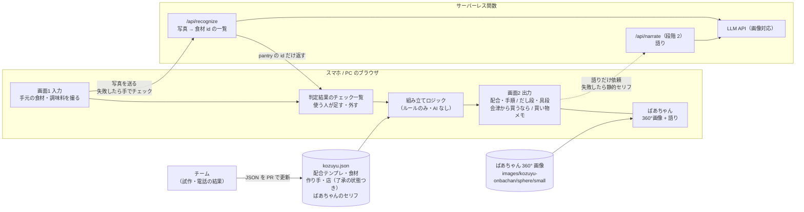

# こづゆばあちゃんの台所：システム構成・機能（案）

作成: 2026-10-21 ／ 状態: **案**（技術スタックは 10/26 に決定。7 章）

画面の中身は R02 の最終案（`loop/rounds/R02/converge.md`「最終案」）で決まっている。ここでは、それを **11/8 までに動かすための作り** を決める。

前提にしたこと:

- 11/8 まで残り 18 日。10/26 の進捗確認②までに「入力 → 出力の 2 画面を公開 URL で動かす」（[模擬審査 D](products/reverse-chef-mock-judging.md#d-入力--出力の-2-画面を公開-url-で動かす)、+5〜7 点の見込み）
- 機能を増やしても点は上がらない（模擬審査「やっても点にならないこと」）。**作るのは R02 の画面 2 枚だけ** にする
- 配合・産地・作り手名・リンク・食べ比べの結果は、人が確かめた静的データからしか出さない（R02 決定）。AI に数字や店名を作らせない
- **本物のこづゆとの比較と割合（再現度・食べ比べの結果・基準にするこづゆ）は、こづゆに詳しい人へのヒアリングの後に設計する**（2026-10-21 チーム判断）。今は作らず、あとから足せる枠だけ空けておく（3 章「保留」）
- **入力は、手元の食材の写真を撮って AI が判定し、結果を使う人が直す形にする**（2026-10-26 変更）。家にあるものを一覧から探してチェックするのは手間がかかるため。判定結果はチェック一覧に反映し、そのまま編集できるようにする（M1・M2）

---

## 1. ひとことで言うと

**静的 Web アプリ＋サーバーレス関数 1 本。こづゆ 1 品分のデータ（JSON 1 ファイル）を、ブラウザの中のルールで組み立てて表示する。**
AI は「写真に写った食材の判定」に使う（あとから「ばあちゃんの語り」も足せる）。AI が止まっても、チェック一覧を手で入れれば画面は出る作りにする。

---

## 2. 全体の構成



| 部品 | 役割 | どこに置くか |
|---|---|---|
| 画面 2 枚 | 入力 → 出力。スマホ縦画面を基本にする（QR カードから開く想定） | 静的ホスティング |
| 組み立てロジック | チェックされた材料から、配合テンプレと各食材の代わりを選ぶ。純粋な関数 1 つにする | ブラウザ内 |
| `kozuyu.json` | 画面に出る事実のすべて。チームが試作・電話の結果で更新する | リポジトリ（画面と一緒に配信） |
| ばあちゃん画像 | 360° 画像（既存 620 枚）。判定の場面で回す | リポジトリ |
| `/api/recognize` | 写真を受け取り、画像対応の LLM に写っている食材を判定させて、`pantry` の id の一覧だけを返す。API キーを隠すためのサーバーでもある | サーバーレス関数（Vercel Functions） |
| `/api/narrate`（段階 2） | 結果をばあちゃんの口調で語らせる | サーバーレス関数 |

**DB・ログイン・ユーザー登録は作らない。** 保存したいものが無い（買い物メモはコピーで持ち帰る）。写真も判定に使うだけで保存しない。

---

## 3. 機能一覧と優先度

VPC の困りごと（[VPC 2 章](products/reverse-chef-vpc.md#2-課題何に困っているか)）とのつながりを右に書いた。

### Must：10/26 までに公開 URL で動かす

| # | 機能 | 中身 | 答える困りごと |
|---|---|---|---|
| M1 | **入力：写真から食材を判定** | 冷蔵庫・棚・買ってきた袋などを撮る（複数枚可）。`/api/recognize` が写っている食材を判定し、M2 のチェック一覧に印を付けた状態で出す。判定できないものは無理に当てず、何も付けない | 家にあるものを一覧から探すのが手間 |
| M2 | **入力：判定結果を直すチェック一覧** | 10 個前後のチェックボックス（だしの素／白だし／オイスターソース／鶏ガラ／里芋 or じゃがいも／干し椎茸 or 生椎茸／高野豆腐 or お麩／しらたき／人参／きくらげ）。AI の判定の間違いを、使う人が付けたり外したりして直す。写真を撮らずにここから手で入れることもできる（AI が止まったときの逃げ道にもなる）。数字・作り手名・AiCT の語は置かない | 材料が手に入らない |
| M3 | **出力：配合と手順** | 固定の配合テンプレから、チェックに一番近いものを出す。大さじ・小さじ、レンジ中心。分量はチームの試作で決める（それまでは仮の値で画面を通す） | 手間と時間がかかる／レシピが本物ありき |
| M4 | **出力：だし段・具段の対比表** | 「本来の材料 → 代わり」を、だし段（干し貝柱・干し椎茸）と具段（豆麩・糸こん・里芋・人参）に分けて並べる | 何が「らしさ」か分からない |
| M5 | **出力：会津から買うなら** | 食材の行に、会津で作られているもの／会津若松の事業者が売っているものと、今ある買い方（店頭・帰省・実家・通販。通販は送料込み総額）。了承の状態で出し方を変える（5 章） | 材料が手に入らない → 本物への入口 |

### Should：11/8 までに足す

| # | 機能 | 中身 | メモ |
|---|---|---|---|
| S1 | **ばあちゃんの買い物メモ＋コピー** | 3 行までのメモをクリップボードへ。Web Share API は対応ブラウザだけで使い、コピーを基本にする | 帰省・仕送りのときに使う。デモの締め |
| S2 | **ばあちゃんの判定シーン** | 入力 → 出力の間に 360° 画像を 1〜2 秒回して「どれどれ…」→ 結果。既存の `preview.html` の回転ロジックを移植 | 模擬審査「ローディングではなく判定の場面で使う」(+1) |
| S3 | **ばあちゃんのセリフ（静的）** | 場面ごとのセリフを JSON に書いておく（あいさつ／だし段の解説／足りなかった食材の一言）。干し貝柱は「北前船で来た乾物」として語らせる | 模擬審査の小さな加点 (+1) |
| S4 | **「会津で食べるなら」1 行** | 了承が取れた飲食店 1 軒だけ。取れなければ行ごと出さない | [open-questions 3-10](open-questions.md) |
| S5 | **根拠の表示** | 出力の下に「作り手名は電話で確認した分だけ」などの注記。データの出どころ（静的データか AI か）が分かるようにする | 「ChatGPT に聞けばよくない？」への答えを画面で見せる |

### Could：余裕があれば

| # | 機能 | 中身 | 注意 |
|---|---|---|---|
| C1 | **AI の語り**（`/api/narrate`） | 選ばれた結果（JSON の該当部分）だけを渡し、ばあちゃんの口調で語りを書かせる。数字・店名・リンクは渡したもの以外を出させない | 失敗・遅延・オフライン時は S3 の静的セリフに戻す。デモでは切り替えスイッチを持つ |
| C2 | **効果の数え方** | QR カードの URL に `?src=card` を付け、開いた数とメモのコピー数だけを数える。個人情報は取らない | 模擬審査「効果の数え方を 1 つ決めて 11/8 に測る」(+0.5〜1)。ブースが無いなら不要 |
| C3 | **自由入力の材料** | チェックに無い材料を文字で入れたら、AI が既知の材料に寄せる | `/api/recognize` と同じ仕組みで作れる |

### 保留：本物のこづゆとの比較（ヒアリングの後に設計する）

こづゆに詳しい人へのヒアリングで、基準にするこづゆ・外せない材料・代わりがきかない材料が分かってから、見せ方と測り方を決める。今は作らない。

- 本物との比較の見せ方（R02 案は食材ごとの「代用で足りた／足りなかった」タグ＋差の種類）
- 割合・再現度を出すか、出すならどう測るか（[open-questions 1-1・2 章](open-questions.md)）
- 基準にするこづゆ（[open-questions 1-3](open-questions.md)）と食べ比べの設計

あとから足しやすいように、出力画面の各行に表示欄を 1 つ足せる作りにしておく。JSON には `parts` の各行に項目を足せばよい（4 章）。「会津から買うなら」をどの行に出すかも、比較の結果が出たら見直す（今はデータがある行すべてに出す）。

### 作らない（Issue に積むだけ）

- こづゆ以外の料理、「うちの味」の保存・家族共有
- 「どうだった？／何が足りなかった？」の回答・集計画面（R02 で「次にやるなら」に回した）
- ログイン、DB、カート・決済（通販はリンクまで。カートには行かない）

---

## 4. データの持ち方（`kozuyu.json`）

画面に出る事実はすべてこの 1 ファイルに入れる。**チームの誰でも、試作や電話の結果を JSON の書き換え（PR）で反映できる** ようにする。

```jsonc
{
  "dish": "こづゆ",
  "pantry": [                           // 画面 1 のチェック項目
    { "id": "dashinomoto", "label": "だしの素", "group": "調味料" },
    { "id": "oyster",      "label": "オイスターソース", "group": "調味料" },
    { "id": "koya",        "label": "高野豆腐 or お麩", "group": "具" }
  ],
  "parts": [                            // だし段・具段の各行
    {
      "id": "kaibashira",
      "section": "dashi",               // dashi | gu
      "original": "干し貝柱",
      "substitutes": [                  // 上から順に、材料がそろうものを選ぶ
        { "requires": ["dashinomoto", "oyster"], "text": "だしの素＋オイスターソース少々" },
        { "requires": ["dashinomoto"],           "text": "だしの素" }
      ],
      "note": "貝柱は会津も北海道・青森から買っている乾物",
      "aizu": []                        // 会津から買うなら（下の sources の id）
      // 本物との比較の項目は、ヒアリング後の設計で決めてここに足す（3 章「保留」）
    }
  ],
  "templates": [                        // チームが試作した配合を置く
    {
      "id": "all_sub", "label": "全部代用",
      "requires": ["dashinomoto", "oyster"],
      "amounts": [{ "item": "水", "qty": "400ml" }],
      "steps": ["耐熱ボウルに…", "レンジ 600W で 3 分"]
    }
  ],
  "sources": [                          // 作り手・売っている店・食べられる店
    {
      "id": "matsubaya",
      "kind": "maker",                  // maker | seller | restaurant
      "name": "松葉屋商店",
      "consent": "none",                // confirmed | public_only | none
      "how": ["県内の店頭"],
      "price_note": null,
      "url": null,
      "checked_at": null                // 電話・棚で確かめた日
    }
  ],
  "lines": {                            // ばあちゃんの静的セリフ（S3）
    "greeting": "今日の台所でこづゆ作ってみっか",
    "kaibashira": "貝柱はな、北前船で来た乾物だ…"
  }
}
```

（中の値は形を示すための例。配合・分量・手順・店の情報は、試作と電話のあとでチームが入れる）

---

## 5. 組み立てのルール

AI を使わず、次のルールだけで出力を作る。ルールが単純なので、チームの誰が見ても「なぜこの結果か」を説明できる。

1. **配合テンプレを選ぶ**: `templates` を上から順に見て、`requires` がすべてチェックされている最初のものを選ぶ（並び順が優先順位）。どれもそろわなければ「これだけは用意してけろ」と、1 つあれば作れる材料を出す
   - 10/26 に「そろっている数が一番多いもの」から変えた。数で選ぶと、干し貝柱を持っていても「だしの素＋オイスターソース」（2 つ）が「干し貝柱のだし」（1 つ）より優先されてしまうため
2. **各行の代わりを選ぶ**: `parts` ごとに、`substitutes` を上から見て `requires` がそろう最初のものを出す。無ければ「省略」または「本物を用意」
3. **会津から買うなら**: `aizu` がある行に出す（どの行に出すかは、本物との比較を設計したあとに見直す）。作り手・店の名前の出し方は了承の状態で変える

   | `consent` | 画面での出し方 |
   |---|---|
   | `confirmed` | 名前・買い方・リンクを出す |
   | `public_only` | 名前と買い方を出し、「公開情報より」と添える。リンクは公開ページだけ |
   | `none` | 名前は出さず「会津若松の事業者が売っているもの」と書く |

4. **数字は JSON にあるものだけ**: 画面に出る数字（分量・送料込み総額）は、すべて JSON からの引用にする

このロジックは入力（チェックの配列）と JSON を受け取って出力を返す関数 1 つにまとめ、テストを書く（試作やヒアリングの結果で JSON が変わっても壊れていないことを確かめるため）。

---

## 6. AI を使う場所（M1・段階 2 の C1）

| AI がすること | AI にさせないこと |
|---|---|
| （M1）写真に写っている食材を、`pantry` の id から選ぶ | `pantry` に無い食材名を返す（返ってきたら捨てる） |
| （C1）選ばれた結果を、ばあちゃんの口調で 3〜5 文に語る | 配合・分量・手順を作る |
| （C3）自由入力の材料を、既知の材料 id に寄せる | 作り手名・店名・リンク・価格を出す |
| | 再現度などの数字を出す |

### 写真の判定（M1）

- **渡すもの**: 写真と、`pantry` の id とラベルの一覧だけ。「この一覧のどれが写っているか、id の配列で答える。分からないものは入れない」と指示する
- **返ってきた結果の確認**: 一覧に無い id は捨てる。判定はチェック一覧に印を付けるだけで、そのまま出力には進まない（必ず M2 で使う人が確かめる）
- **間違えやすいもの**: 干し椎茸と生椎茸、しらたきと糸こんにゃく、だしの素と白だし など、袋や瓶の見た目が似ているもの。M2 で直せることを画面で伝える
- **写真は保存しない**: 判定に使ったら捨てる。ログにも残さない
- **止まっても動く**: タイムアウト（数秒）・エラー・オフラインのときは「手で選んでけろ」と M2 を空の状態で出す

### ばあちゃんの語り（C1）

- **渡すもの**: 5 章のルールで決まった結果（JSON の該当部分）と、ばあちゃんの口調の説明だけ
- **出てきた文の確認**: 渡していない数字や固有名詞が入っていたら捨てて、静的セリフを出す
- **止まっても動く**: タイムアウト（数秒）・エラー・オフラインのときは静的セリフ。デモ当日は会場の回線が読めないので、AI を切るスイッチを持つ

### 共通

- **API キー**: サーバーレス関数の環境変数にだけ置く。`.env.example` にキー名だけ残す
- **どの LLM を使うか**: 未定。M1 で使うので、**画像を読める LLM** を早めに決める。費用の概算もあわせて出す（[open-questions 1-12](open-questions.md)）

発表では「食材の判定と言葉は AI、数字と店の名前は人が確かめたデータ」という境界を 1 枚で見せる（模擬審査「LLM／静的データの境界 1 枚」）。

---

## 7. 技術スタックの候補（要合意）

どれでも 5 章までの作りは同じ。違うのは書きやすさと公開のしかた。

| 案 | 中身 | 良い点 | 気になる点 |
|---|---|---|---|
| **A. 素の HTML/CSS/JS** | ビルドなし。GitHub Pages か Vercel で公開 | 一番シンプル。既存の `preview.html` と同じ書き方。誰でも開いて直せる | 画面が増えると散らかりやすい。テストの仕組みを自分で用意する |
| **B. Vite + React + TypeScript** | Vercel で公開。段階 2 の関数も同じリポジトリに置ける | 生成 AI で書かせやすい。PR ごとにプレビュー URL が出てレビューしやすい。ロジックのテスト（Vitest）が簡単 | Node.js の環境が要る。React を触ったことが無い人には最初の壁 |
| C. Next.js | Vercel で公開 | 段階 2 まで 1 つで済む | 画面 2 枚には大きすぎる |
| D. ノーコード（STUDIO・Glide など） | 画面をツール上で作る | 見た目を早く作れる | 5 章のルール、360° 画像、JSON の PR 更新が難しい |

**推奨は B**（チームに React を少しでも触った人がいれば）。いなければ **A** で、公開先は同じく Vercel にしておくと段階 2 の関数を後から足せる。

> **決定（2026-10-26）**: **B. Vite + React + TypeScript** に Tailwind CSS を足して、Vercel で公開する。チームの複数人がコードを触り、React 経験者がいるため。詳細は `AGENTS.md`「技術スタック」。

決めたら `AGENTS.md` の「技術スタック」「コマンド」と `.github/workflows/ci.yml` を更新する。

---

## 8. 運用と費用（実現性・継続性 20 点向け）

| 項目 | 今の見込み |
|---|---|
| サーバー代 | 静的ホスティングの無料枠に収まる見込み（画面 2 枚・画像 620 枚・アクセスは発表時のみ） |
| AI の利用料 | 写真の判定（M1）で毎回かかる。1 回の判定（写真の枚数 × 単価）と、段階 2 をやるなら語りの文字数 × 単価で概算を出す（LLM が決まったら） |
| データの更新 | 作り手・店の情報が変わったら `kozuyu.json` を直す。`checked_at`（確かめた日）を画面に出し、古くなったら分かるようにする |
| 11/8 以降に誰が続けるか | 未定（[open-questions 1-12](open-questions.md)）。「静的データと手入力だけなら月 0 円で置いておける。写真の判定は使われた回数だけ費用がかかる」と言える |

---

## 9. 11/8 当日の備え

- 会場の回線が無くても動くように、手元の PC でも同じものを開けるようにする（静的なので、ビルドしたファイルを開くだけ）
- 写真の判定はデモの見せ場なので使う。ただし回線が無いときに備えて、M2 の手入力だけで最後まで通せることを確かめておく。判定に使う写真も事前に撮っておく
- ばあちゃんの語り（C1）は切っておく（または切るスイッチを持つ）
- 1 分デモ（R02「11/8 で見せるもの」）の操作を録画しておき、動かなかったら動画を流す

---

## 10. 進め方

| 期間 | やること | 終わったら言えること |
|---|---|---|
| 〜10/23 | スタック決定。`kozuyu.json` の骨組み（分量は仮の値） | — |
| 〜10/26 | M2〜M5（手入力 → 出力）を公開 URL で動かす。活動ログに URL とスクリーンショット | 「入力 → 出力が動く」 |
| 〜10/31 | LLM を決めて、M1（写真の判定）を足す | 「写真を撮るだけで、作れるこづゆが出る」 |
| 10/26〜11/1 | 試作・電話の結果を JSON に入れる。S1〜S5。ヒアリングが済んだら本物との比較を設計（3 章「保留」） | 「作り手名は電話で確かめた分だけ」 |
| 11/1〜11/6 | （余裕があれば）C1・C2。発表スライドに画面を入れる | 「言葉は AI、事実は人が確かめたデータ」 |
| 11/7 | 動作確認、録画、回線なしでも通せるか確認 | — |

---

## 11. まだ決めていないこと

| # | 決めること | 関係 |
|---|---|---|
| 1 | 技術スタック（7 章の A〜D） | [open-questions 1-9](open-questions.md) |
| 2 | 写真の判定に使う LLM（画像対応）。段階 2（AI の語り）をやるか | 6 章、[open-questions 1-12](open-questions.md) |
| 3 | 効果を数えるか（C2）。数えるなら何を | ブースの有無（[open-questions 1-4](open-questions.md)）しだい |
| 4 | 画面のデザイン（色・フォント）とばあちゃんの口調 | 2 画面が動いてから |
| 5 | 本物のこづゆとの比較・割合の見せ方と測り方 | こづゆに詳しい人へのヒアリングの後（3 章「保留」） |
