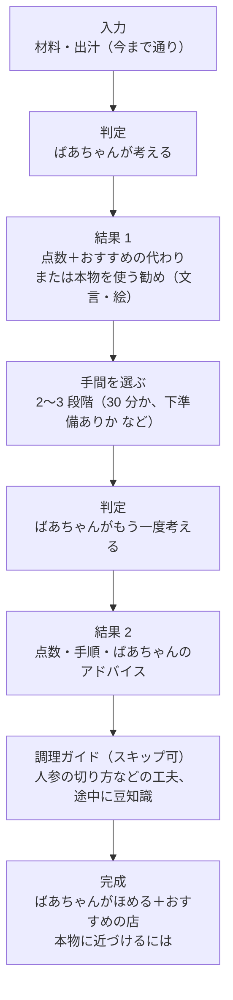

# ヒアリング結果：田季野（たきの）さん（10/26）

作成: 2026-10-27

会津若松の郷土料理店「田季野」さんに、10/26 にこづゆの話を聞いた結果。
準備・質問リストは [hearing-takino.md](hearing-takino.md)。この資料は、チームの Google ドキュメント「質問まとめ」（お店への共有資料・確認資料・ヒアリングまとめ・今後どうするか・画面遷移のイメージ）を docs に写して整理したもの。

| 章 | 中身 |
|---|---|
| 1. お店から聞いたこと | 事実。画面やデータに使ってよい根拠の候補 |
| 2. チームの感想 | 食べてみて、聞いてみて思ったこと（事実ではない） |
| 3. 記録できていないこと | 当日の質問のうち、記録に残っていないもの |
| 4. 今の docs・実装とのずれ | 聞いた話と、いま決まっていること・作ってあるものが食い違うところ |
| 5. チームの案（未合意） | ヒアリング後にチームで出た実装の案と、画面遷移のイメージ |
| 6. 次にやること | 検証と調べもの |

関連: [これから決めること](open-questions.md) / [システム構成（案）](architecture.md) / [こづゆの作り方：資料ごとの違い](kozuyu-variations.md)

---

## 1. お店から聞いたこと

### 1-1. 一番大事なのは「出汁」

- お店の出汁の材料は **貝柱・昆布・干し椎茸**。これらを **一晩水に浸して** しっかり出汁を取る
- 出汁を十分に取ると、調味料や塩を控えてもうま味のある味になる（**減塩につながる**）
- 本場に近づけたいなら、できるだけ伝統的な食材を使い、出汁を丁寧に取るのがよい

[kozuyu-variations.md](kozuyu-variations.md) 1 章では「県民調査では、会津ではかつお・昆布を使う人が少ない」「店と家で分かれている可能性」と書いていた。田季野さんは昆布を使う店なので、この推測と合う。

### 1-2. 代わりの材料はあり得るが、味は変わる

| 本来の材料 | お店が挙げた代わり | お店の見立て |
|---|---|---|
| 貝柱（出汁） | 鰹出汁、ほんだし | 貝柱と鰹では風味もうま味も大きく違う。本来のこづゆとは違う味になる可能性が高い |
| 里芋 | じゃがいも | 身近な食材としては挙げられる。食感は変わる。鰹出汁と組み合わせる案も出た |
| 豆麩 | 豆腐、油揚げ | 家にある食材を使う方法として挙げられた |

**お店もこれらの代わりで実際に作ったことはない。** 「代わりにできる」と言い切らず、作って確かめる必要がある。

### 1-3. こづゆには「特別感」がある

- こづゆはふだんの汁物ではなく、**特別な場で食べる郷土料理**。お正月・お盆・お祝い事・仏事などの行事
- 「**こづゆは赤飯のような存在**」という例えが出た。料理そのものだけでなく、食べる場面や伝統も含めて価値がある
- 材料を手軽なものに置き換えるだけだと、この特別感が薄れるおそれがある

### 1-4. 家や店によって作り方が違う

- こづゆは家ごと・店ごとに味や作り方がある
- 田季野さんも、大人数に出すために家庭とは違う作り方・工夫をしている
- **1 つのお店のレシピを「唯一の正しいこづゆ」として出すのはよくない**

### 1-5. 豆知識（聞き取ったまま）

- 具の数について、偶数の日はお祝い事、奇数は普通の日、のような話があった（**要確認**。4 章）
- 皿が小さいのは、何回でもおかわりできるようにするため
- お店でこづゆの出汁を使った商品を出しているらしい（**要確認**。「会津から買うなら」の候補になる）

---

## 2. チームの感想

- こづゆを作るには、まず出汁。そこに料理の技術と食材が大事だと分かった
- 食べてみて、**豆麩が重要**だと分かった。豆腐・油揚げで代わりにすると、油が多すぎたり、あの食感が出せなかったりしそう。ただ感じ方は人それぞれなので、試す必要はある
- お店も代わりで作ったことがないので、検証は難しそう
- いろいろな食材で試すと、費用がかかりすぎるかもしれない

---

## 3. 記録できていないこと

[hearing-takino.md](hearing-takino.md) 4 章の記録シートの項目のうち、Google ドキュメントに記録が無いもの。覚えている人がいたら追記する。

| 項目 | 状態 |
|---|---|
| 話してくださった方・聞いた人・録音の了承 | 記録なし |
| 分量（4 人分の貝柱・醤油など）・味付け（塩・醤油・酒・みりん） | 記録なし。`kozuyu.json` の分量はまだ直せない |
| 具の一覧、切り方、里芋の下ごしらえ（B9〜B12） | 記録なし |
| 代わりがきかない材料の順番（B15） | 記録なし。感想では豆麩と出汁（貝柱）が挙がった |
| 再現度を数字にすることへの意見（C1〜C5） | 記録なし |
| お店の名前を出してよいか（D2）、基準として使ってよいか（D1）、食べ比べの味見（D3） | 記録なし。**名前を出す了承が取れるまで、アプリ・発表では「会津若松の郷土料理店」と書く** |

---

## 4. 今の docs・実装とのずれ

| 聞いた話 | 今の docs・実装 | どうするか |
|---|---|---|
| 1 つの店のレシピを唯一の正解にしない（1-4） | [open-questions 1-3](open-questions.md) の基準の選択肢に「ヒアリングで教わった店のレシピ」がある | 基準は「荒木ら 2018 の基本条件＋チームで固定した分量」寄りにし、画面で「家や店ごとに違う」と書く案。チームで決める |
| 貝柱 → 鰹・ほんだしは大きく違う（1-2） | `kozuyu.json` の `substitutes[].closeness` は仮の値 | 出汁の試作（6 章）の結果で直す。それまでは「見込み」のまま |
| 豆麩 → 豆腐・油揚げ（1-2） | M2 のチェック一覧は「高野豆腐 or お麩」 | 豆腐・油揚げを足すかは試作しだい。感想では食感が難しそう |
| 具の数：偶数はお祝い、奇数は普通の日（1-5） | [kozuyu-variations.md](kozuyu-variations.md) 4 章では「7 種か 9 種の奇数が縁起がよい」が 5 件 | 聞き違いの可能性がある。お店か資料で確かめるまで、画面にもセリフにも出さない |
| 特別な日の料理（1-3） | 画面は材料と手順が中心で、行事の話は無い | ばあちゃんのセリフ（S3）や豆知識で行事に触れる案（5 章） |
| チームの案の対象は「一人暮らしの学生や若者」（5 章） | VPC・発表の対象は「県外にいる会津出身者」 | 両方を含めるか、どちらかに絞るか、チームで決める |
| チームの案に「再現度 87%」「残りの 13%」がある（5 章） | [open-questions 2-4](open-questions.md) は「会津の味の 87% とは言わない」、[1-2](open-questions.md) は打ち出しの言葉が未定 | 数字を出すなら「基準のこづゆとの近さ（見込み）」と書く。打ち出しは 1-2 で決める |

---

## 5. チームの案（未合意）

ヒアリングの後、チームの Google ドキュメントに書かれた案。まだ合意していない。

### 5-1. ヒアリングから出た大きな方向

1. **手軽に作ることと、本来のこづゆを知ることを分ける。** 「手軽に作れるこづゆ風の料理」と「本来のこづゆ」を区別し、代わりのレシピと一緒に、伝統的な材料・作り方との違いを説明する
2. **レシピだけでなく、文化やストーリーを伝える。** なぜお正月やお祝い事で食べるのか、会津の人にとってどんな存在か
3. **アプリでの体験を、会津での食体験につなげる。** 代わりのレシピで作ったあとに、本場の材料や「本場のこづゆを食べられるお店」を案内する

あわせて出た案: 出汁の取り方と、出汁を取ると減塩になることを伝える（健康面の価値）。お正月・お盆に合わせてこづゆ作りを勧める。

### 5-2. 「二択にしない」方針

- 対象: 手間や時間をかけられない一人暮らしの学生・若者（入口のこづゆを求めている層）
- 最初から「本物モード／お手軽モード」の 2 つに分けると、対象が割れ、手軽に作りたい人に「手抜き」の後ろめたさを与える
- 入口は常に「手元の材料での手軽な再現」。作ったあとの画面で「味の正体（うま味の重ね方）」を説明し、足りない分（本物の香りと食感）を本場・お店の価値として伝える

### 5-3. 「手間レベル」を選ぶ（1 タップ追加）

今のモックアップは、材料を選んでから完成までの手間（出汁を取る時間・切り方）が 1 通りに決まっている。材料を選んだあとに、その日の気力と時間で選べるようにする案。

| レベル | 中身 |
|---|---|
| 爆速 5 分 | 包丁なし。お湯と調味料を注ぐだけ |
| 標準 15 分 | 手元の野菜を小さく切って煮る |
| ちょい本格 30 分 | 具の下ゆでや、じっくり煮出す工程を入れる |

### 5-4. 画面遷移のイメージ

今の「入力 → 判定 → 出力」を、次のように伸ばす案。

今の実装（[architecture.md](architecture.md) M1〜M5・S2）にあるのは A〜C と F の一部まで。D・E・G・H は新しく作る部分になる。architecture の「機能を増やしても点は上がらない」とどう両立させるかは、チームで決める。

---

## 6. 次にやること

| # | やること | 中身 | 優先度 |
|---|---|---|---|
| 6-1 | **出汁だけの試作（3 パターン）** | ① 本物基準（貝柱＋椎茸＋昆布） ② 貝類の代わり（ホタテ水煮缶など） ③ 家の調味料の代わり（顆粒だし＋オイスターソース） | 高 |
| 6-2 | **お店や詳しい人に味見してもらう** | 「どれがおいしいか」ではなく「どこまでがこづゆの風味として許せる境界か」を見てもらい、点数の根拠（一次情報）にする | 高 |
| 6-3 | 具の代わりの比較 | 里芋とじゃがいも、豆麩と豆腐・油揚げ。味・香り・食感・見た目の違いを整理する | 中 |
| 6-4 | こづゆの歴史・文化を調べる | お正月やお祝い事で食べる理由、会津の人にとっての意味。具の数の偶数・奇数（4 章）もここで確かめる | 中 |
| 6-5 | 基本レシピを整理する | 一般的な材料、出汁の取り方、手順、家や店ごとの違い。[kozuyu-variations.md](kozuyu-variations.md) を土台にする | 中 |
| 6-6 | 記録の抜けを埋める | 3 章の項目。特に名前の掲載と、基準として使ってよいかの了承 | 中 |
| 6-7 | 別チームの質問を確認する | 会津の郷土料理の種類、わっぱ飯の位置づけ、郷土料理の歴史・豆知識 | 低 |
